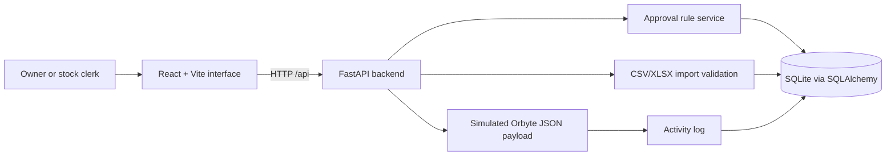

# Architecture

React interface -> FastAPI inventory and workflow APIs -> SQLAlchemy -> SQLite.

`src/main.py` serves the built React application and API on the same port.
During development, Vite runs separately and proxies `/api` requests to FastAPI.
Orbyte integration is simulated. The application currently has no GPU workload.
